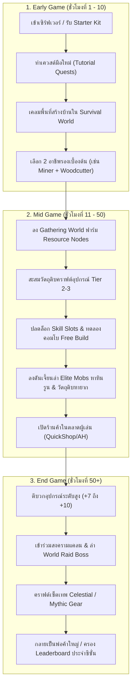
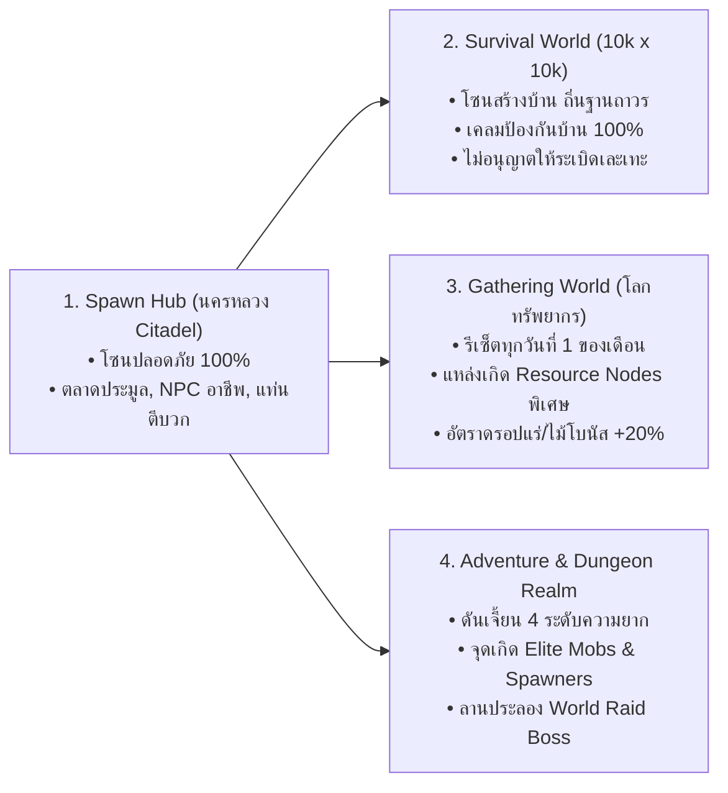
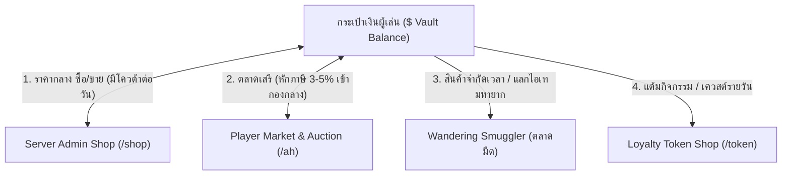
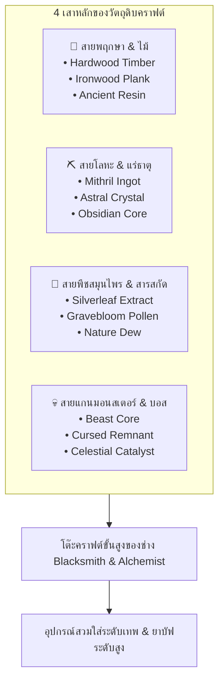
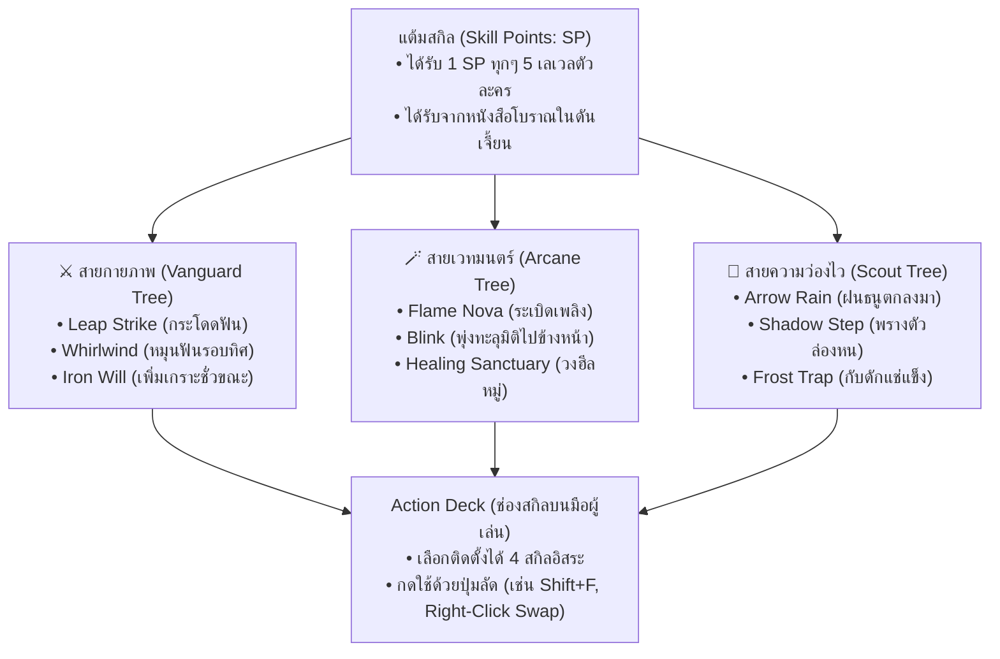
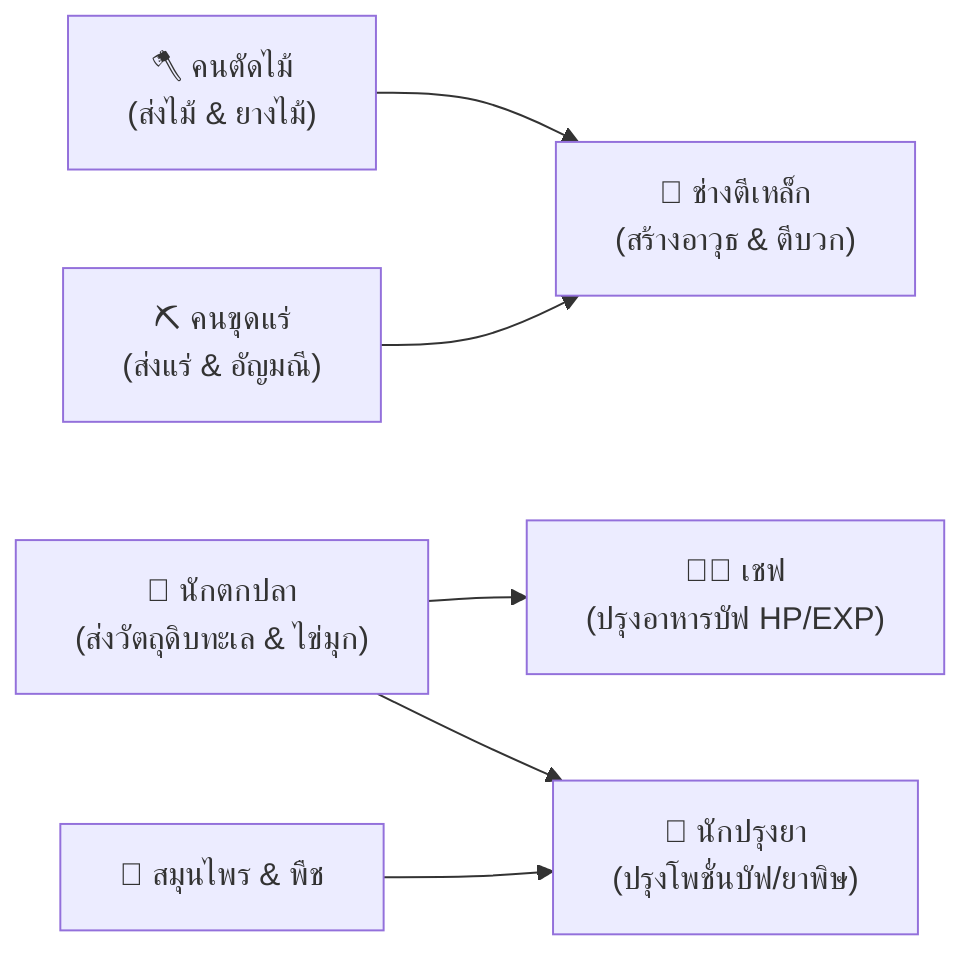

# ⚔️ แผนผังการออกแบบระบบเกมเชิงลึก (Game Design Specification)
## Minecraft Pure Survival MMORPG-Hybrid (Purpur 26.3 / Java 25)

> **โครงการ**: Pure Minecraft Survival (Semi-MMO & Community Hybrid)  
> **สถานะ**: เอกสารสเปกแกนกลางการออกแบบระบบเกม (Core Game Design Blueprint)  
> **ผู้จัดทำ**: Lead Systems Architect  
> **ทีมรับผิดชอบ**: **คุณมด** (System & Plugin Integration) & **คุณนิว** (Balancing, Config & Economy)  
> **เอกสารคู่ขนาน**: [HANDOVER_SPECIFICATION.md](file:///c:/Users/_newgen/Documents/antigravity/Survival/docs/HANDOVER_SPECIFICATION.md) | [Google Sheets Truth Engine](https://docs.google.com/spreadsheets/d/11hZOHenib5-hMHXeg4HUWR_QvEE462qON4LtOZMkdvY/edit?usp=sharing)

---

## สารบัญระบบ (Systems Table of Contents)
1. [วงลูปหลักของเกม (Core Game Loop & Player Lifecycle)](#1-วงลูปหลักของเกม-core-game-loop)
2. [โมเดลเศรษฐกิจและอัตราการหาเงินต่อชั่วโมง (Income per Hour & Economy)](#2-โมเดลเศรษฐกิจและอัตราการหาเงินต่อชั่วโมง)
3. [สถาปัตยกรรมแผนที่และการแบ่งโซนโลก (World Zoning & Map Layout)](#3-สถาปัตยกรรมแผนที่และการแบ่งโซนโลก)
4. [ลำดับชั้นมอนสเตอร์และระบบบอส (Mob Tiers, Elites & World Bosses)](#4-ลำดับชั้นมอนสเตอร์และระบบบอส)
5. [ระบบเก็บเกี่ยวทรัพยากร (Gathering & Respawning Resource Nodes)](#5-ระบบเก็บเกี่ยวทรัพยากร-gathering-nodes)
6. [โครงสร้างยศและสายความก้าวหน้า (Rank Progression: Free vs Donor)](#6-โครงสร้างยศและสายความก้าวหน้า)
7. [ระบบสมาชิกพรีเมียมรายเดือน (Monthly Premium / Adventurer Pass)](#7-ระบบสมาชิกพรีเมียมรายเดือน)
8. [ช่องทางการค้าและระบบร้านค้าในเกม (In-Game Shops & Trading Channels)](#8-ช่องทางการค้าและระบบร้านค้าในเกม)
9. [สารบบไอเทมและอุปกรณ์คราฟต์พิเศษ (Custom Craftable Items & Gear Sets)](#9-สารบบไอเทมและอุปกรณ์คราฟต์พิเศษ)
10. [ระบบวัตถุดิบคราฟต์และอัตราการดรอป (Crafting Materials & Catalyst Drops)](#10-ระบบวัตถุดิบคราฟต์และอัตราการดรอป)
11. [ระบบตีบวกและยัดรูนอัญมณี (Refinement & Socketing Runes)](#11-ระบบตีบวกและยัดรูนอัญมณี)
12. [เอนแชนต์เฉพาะทางสนับสนุนการฟาร์ม (Custom Gathering Enchants)](#12-เอนแชนต์เฉพาะทางสนับสนุนการฟาร์ม)
13. [ระบบสกิลแบบ Free Build (Open Skill Tree & Action Deck)](#13-ระบบสกิลแบบ-free-build)
14. [ระบบ 6 อาชีพรองและการบูรณาการ (6 Sub-Jobs & Profession Matrix)](#14-ระบบ-6-อาชีพรองและการบูรณาการ)
15. [แผนผังปลั๊กอินและแนวทางการคอนฟิก (Plugin Mapping & Implementation Guide)](#15-แผนผังปลั๊กอินและแนวทางการคอนฟิก)

---

## 1. วงลูปหลักของเกม (Core Game Loop)

วงจรชีวิตของผู้เล่นถูกออกแบบให้มีจุดหมายชัดเจนในทุกช่วงเวลา ไม่น่าเบื่อ และไม่มีทางตัน (No Dead-End Loop):



---

## 2. โมเดลเศรษฐกิจและอัตราการหาเงินต่อชั่วโมง

โครงสร้างเศรษฐกิจถูกควบคุมอย่างเข้มงวดเพื่อป้องกันภาวะเงินเฟ้อ (Hyperinflation) โดยแบ่งระดับรายได้ต่อชั่วโมงตามช่วงพัฒนาการของผู้เล่น:

| ช่วงพัฒนาการของผู้เล่น | รายได้เฉลี่ย ($/ชม.) | แหล่งที่มาของรายได้หลัก (Income Sources) | ช่องทางดูดเงินออกจากระบบ (Money Sinks) |
| :--- | :--- | :--- | :--- |
| **Early Game** (Lv 1-15) | **$1,500 - $3,000** | • ขายผลผลิตเกษตรขั้นต้น (ข้าว, แครอท) ให้ Server Shop<br>• ค่าจ้างขุดแร่/ตัดไม้พื้นฐานจากระบบ Jobs<br>• รางวัลจากเควสต์ประจำวัน (Daily Quests) | • ค่าธรรมเนียมเคลมบล็อกเพิ่ม<br>• ค่าซื้อเมล็ดพันธุ์และเครื่องมือเริ่มต้น<br>• ซื้อบล็อกตกแต่งบ้าน |
| **Mid Game** (Lv 16-35) | **$6,000 - $14,000** | • เก็บเกี่ยว Resource Nodes ใน Gathering World<br>• สกัดแร่และขายอัญมณีเจียระไน<br>• ขายอาหารบัฟเชฟ / ยาโพชั่นในตลาดผู้เล่น<br>• ล่ามอนสเตอร์ระดับ Elite ในดันเจี้ยน | • ภาษีซื้อขายในตลาดผู้เล่น (3% - 5%)<br>• ค่าธรรมเนียมสกัด/เจาะรูใส่อัญมณี<br>• ค่าตีบวกอุปกรณ์ระดับ +1 ถึง +6<br>• ค่าอัปเกรดคลังกิลด์ |
| **End Game** (Lv 36+) | **$20,000 - $45,000+** | • ล่าบอสโลก ดรอป Beast Core & Celestial Catalyst<br>• ผลิตอาวุธ/เกราะระดับสูงตีบวกสำเร็จขายในประมูล<br>• รับจ้างตีบวกและเจาะรูน (Blacksmith Service)<br>• เงินปันผลจากระบบแคลน/เมือง | • ค่าธรรมเนียมตีบวกระดับสูง (+7 ถึง +10) และหินกันแตก<br>• ค่ารีเซ็ตแต้ม Skill Tree / สเตตัส<br>• ซื้อฉายา, แฟชั่น, และสัตว์เลี้ยงประดับ<br>• ค่าเช่าพื้นที่ร้านค้าทำเลทองในตลาดกลาง |

> [!IMPORTANT]
> **Dynamic Server Shop Cap**: ร้านค้า Server Shop มีระบบจำกัดโควตารับซื้อผลผลิตเกษตรต่อวัน (Daily Cap) ต่อผู้เล่น เพื่อบีบให้ผู้เล่นนำผลผลิตแปรรูป (เช่น ทำเป็นอาหารบัฟโดยเชฟ) ไปขายต่อในตลาดผู้เล่น แทนที่จะเทขายระบบจนเงินล้น

---

## 3. สถาปัตยกรรมแผนที่และการแบ่งโซนโลก (World Zoning)

เพื่อปกป้องความสวยงามของโลกสร้างบ้าน และป้องกันปัญหา Chunk Lag แบ่งโลกออกเป็น 4 มิติอย่างชัดเจน:



1. **Spawn Hub (The Grand Citadel)**:
   - ปิดความเสียหายทุกชนิด (No Fall Damage, No Hunger, No PvP)
   - จุดตั้ง NPC ประจำ 6 อาชีพ, โต๊ะ Reforge/ตีบวกส่วนกลาง, กระดานเควสต์, และตลาดประมูล Auction House
2. **Survival World (Town & Haven)**:
   - รัศมี 10,000 x 10,000 บล็อก (Pre-generated ล่วงหน้าด้วย Chunky เพื่อ TPS 20.0 นิ่ง)
   - ป้องกันด้วยระบบเคลมพื้นที่ (GriefPrevention / Lands) ป้องกันการขโมยของและทำลายบล็อก
3. **Gathering World (The Wild Frontier)**:
   - ขนาด 5,000 x 5,000 บล็อก ปิดระบบเคลม เพื่อให้ผู้เล่นขุดและตัดไม้ได้อย่างอิสระ
   - **ระบบ Auto-Reset ทุกวันที่ 1 ของเดือน** เพื่อให้ทรัพยากรสดใหม่อยู่เสมอ
4. **Adventure & Dungeon Realm (Ruins of the Fallen)**:
   - โซนอันตราย มอนสเตอร์แข็งแกร่งกว่าโลกปกติ 1.5x - 3x
   - ไม่สามารถทุบบล็อกหรือวางบล็อกได้ มีระบบดันเจี้ยนเขาวงกต และห้องบอส

---

## 4. ลำดับชั้นมอนสเตอร์และระบบบอส (Mob Tiers, Elites & Bosses)

มอนสเตอร์ในเซิร์ฟเวอร์ไม่ได้มีแค่ตัวเดิมๆ ตาม Minecraft Vanilla แต่ถูกแบ่งเป็น 4 ลำดับชั้น:

```
[Tier 1: Wild Mobs] ────────> ซอมบี้/สเกเลตันทั่วไป (HP x1, Dmg x1) ──> ดรอปของ Vanilla
       ▲
[Tier 2: Elite Mobs] ───────> มอนสเตอร์มีออร่าสี & ฉายาพิเศษ ──────────> ดรอป Gem Shards, Skill Scrolls
       ▲
[Tier 3: Dungeon Guardians] ─> มินิบอสประจำดันเจี้ยน (มีหลอดเลือดบอส) ──> ดรอป Runestones, Beast Cores
       ▲
[Tier 4: World Raid Bosses] ─> บอสโลกเกิดตามเวลา (มีกลไก 3 เฟส) ────────> ดรอป Celestial Catalysts, Mythic Blueprints
```

### รายละเอียดคุณสมบัติพิเศษของ Elite Mobs (Affixes System):
- 🩸 **Vampiric (ออร่าสีแดง)**: ดูดเลือด 30% ของความเสียหายที่ทำต่อผู้เล่น
- 🛡️ **Armored (ออร่าสีเทา)**: ลดความเสียหายทางกายภาพลง 50% ต้องใช้เวทมนตร์หรือดาเมจจริง (True Damage)
- ⚡ **Swift / Tempest (ออร่าสีฟ้า)**: เคลื่อนที่เร็วขึ้น 40% และมีโอกาสเรียกลูกเห็บฟ้าผ่าใส่ผู้เล่น
- 💥 **Molten (ออร่าสีส้ม)**: เมื่อตายจะเกิดการระเบิดเพลิงเผาผลาญพื้นที่รอบข้าง

### ระบบ World Raid Boss:
- เกิดทุกวัน วันละ 2 รอบ (19:00 น. และ 22:00 น.) มีเสียงและประกาศแจ้งเตือนทั้งเซิร์ฟเวอร์
- **Anti-Last-Hit Reward Matrix**: คำนวณของรางวัลตามอัตราการทำดาเมจและบทบาท (Damage Dealt, Healing Provided, Tanking Damage) ผู้เล่นทุกคนที่ร่วมสู้อย่างน้อย 3% จะได้รับกล่องสมบัติบอส ไม่มีการแย่งลาสช็อต

---

## 5. ระบบเก็บเกี่ยวทรัพยากร (Gathering & Respawning Resource Nodes)

ใน Gathering World และรอบนอกดันเจี้ยน ทรัพยากรสำคัญจะปรากฏในรูปแบบ **Resource Nodes** ที่สร้างมูลค่าสูงกว่าบล็อกทั่วไป:

| ชนิดของ Resource Node | รูปลักษณ์ในเกม | ความต้องการของเครื่องมือ | ระยะเวลารีสปอว์น | ผลผลิตที่ได้รับเมื่อเก็บเกี่ยว |
| :--- | :--- | :--- | :--- | :--- |
| **💎 Crystal Ore Vein** | ก้อนแร่เรืองแสง Amethyst/Deepslate ผสมอนุภาคละออง | Pickaxe ระดับ Iron ขึ้นไป (ฟัน 4 ครั้ง) | 3 - 5 นาที | • แร่ดิบ 2-4 ก้อน<br>• โอกาส 15% ดรอป *Mithril Nugget*<br>• โอกาส 5% ดรอป *Flawed Gemstone* |
| **🌳 Ancient Timber Node** | ท่อนซุงยักษ์เปลือกไม้โอ๊คดำ มีมอสเกาะ | Axe ระดับ Iron ขึ้นไป (จาม 5 ครั้ง) | 5 - 8 นาที | • ไม้ *Hardwood Log* 4-6 ท่อน<br>• โอกาส 20% ดรอป *Ancient Tree Resin* (ยางไม้โบราณ) |
| **🌿 Mystic Herb Bush** | พุ่มไม้ใบเบอร์รี่เรืองแสง มีละอองเวทมนตร์ | Shears หรือมีดเก็บสมุนไพร | 2 - 4 นาที | • สมุนไพร *Silverleaf* / *Gravebloom* 2-3 ชิ้น<br>• โอกาส 10% ดรอป *Dew of Nature* |
| **🌊 Abyssal Fishing Pool** | จุดน้ำวนมีฟองพวยพุ่งในมหาสมุทรลึก | เบ็ดตกปลา Enchant Lure II+ | 10 - 15 นาที | • ปลาหายากแลกเงินสูง<br>• โอกาส 10% ดรอป *Abyssal Pearl*<br>• หีบสมบัติโบราณก้นสมุทร |

> [!TIP]
> **Anti-AFK Macro Guard**: เมื่อผู้เล่นทำการขุด Node ต่อเนื่อง จะมีระบบสลับตำแหน่งจุดกระทบ (Hit-Spot Marker) ลอยขึ้นมาให้คลิกตามจังหวะ ช่วยให้ผู้เล่นสายฟาร์มมือจริงได้รับ EXP และผลผลิตโบนัสสูงสุด ขณะที่โปรแกรมบอทจะติดขัด

---

## 6. โครงสร้างยศและสายความก้าวหน้า (Rank Progression)

การจัดลำดับยศแบ่งแยกชัดเจนระหว่าง **สายขยัน (Free-to-Play Playtime Ranks)** และ **สายสนับสนุน (Donor Supporter Ranks)** โดยยึดหลัก **"สะดวกสบาย แต่ไม่ P2W"**:

### ก. สายเล่นฟรี (Progression Ranks — ปลดล็อกด้วยเงื่อนไขในเกม)

```
[Novice] ──> [Apprentice] ──> [Adventurer] ──> [Veteran] ──> [Champion] ──> [Legend]
```

| ยศสายฟรี | เงื่อนไขการปลดล็อก (Requirements) | สิทธิ์และโบนัสที่ได้รับ |
| :--- | :--- | :--- |
| **Novice** | เข้าเซิร์ฟเวอร์ครั้งแรก | 1 Home, 1,000 Claim Blocks, สิทธิ์คำสั่งพื้นฐาน |
| **Apprentice** | ออนไลน์ 5 ชม. + มีเงิน $10,000 + ทำเควสต์ครบ 10 เควสต์ | 2 Homes, 2,000 Claim Blocks, ช่องขายของในตลาด 3 ช่อง |
| **Adventurer** | ออนไลน์ 25 ชม. + เลเวลอาชีพใดก็ได้ Lv 15 + $30,000 | 3 Homes, 3,500 Claim Blocks, ช่องขายของ 5 ช่อง, โบนัส EXP Jobs +5% |
| **Veteran** | ออนไลน์ 75 ชม. + เลเวลอาชีพ 2 สายแตะ Lv 25 + $80,000 | 5 Homes, 5,500 Claim Blocks, คำสั่ง `/hat`, ปลดล็อกฉายาสีเขียว |
| **Champion** | ออนไลน์ 150 ชม. + เคลียร์ดันเจี้ยน Tier 3 + $200,000 | 7 Homes, 8,000 Claim Blocks, ลดภาษีตลาดเหลือ 4%, สิทธิ์ประมูลของ 2 ชิ้นพร้อมกัน |
| **Legend** | ออนไลน์ 300 ชม. + มีฉายา Job Master + $500,000 | 10 Homes, 12,000 Claim Blocks, ออร่าดาวทองบนหัว, ฉายาสีทอง `[Legend]` |

### ข. สายผู้สนับสนุน (Donor Supporter Ranks)
- **VIP**: 5 Homes, โต๊ะคราฟต์พกพา (`/craft`), คำสั่งตรวจดูของใกล้ตัว (`/near`), กรอบแชท VIP
- **MVP**: 10 Homes, ทั่งตีเหล็กพกพา (`/anvil`), คลังเอนเดอร์เชสต์พกพา (`/enderchest`), สิทธิ์บินในเขตบ้านตนเอง (`/fly` in claim), ลดภาษีตลาดเหลือ 2%
- **ELITE**: 15 Homes, ถังขยะพกพา (`/disposal`), สิทธิ์บินได้ทั้งใน Survival World (ยกเว้นในโซนดันเจี้ยนและระหว่าง PvP), เอฟเฟกต์ Join Message ทั้งเซิร์ฟเวอร์

---

## 7. ระบบสมาชิกพรีเมียมรายเดือน (Monthly Premium / Adventurer Pass)

ระบบสมาชิกรายเดือนสำหรับผู้เล่นที่ต้องการสนับสนุนเซิร์ฟเวอร์ต่อเนื่อง โดยมุ่งเน้นความคุ้มค่าและของรางวัลประดับบารมี:

### สิทธิประโยชน์สมาชิกพรีเมียม (Monthly Premium Perks):
1. 🎁 **Daily Adventurer Chest**: รับกล่องของขวัญรายวันผ่านคำสั่ง `/pkit daily` (ประกอบด้วย: อาหารบัฟพรีเมียม 2 ชิ้น, หินวาร์ปฟรี, 50 Premium Tokens)
2. ⚡ **Passive Progression Booster**:
   - บัฟ EXP อาชีพรองทั้ง 6 สาย +15%
   - เพิ่มอัตราการดรอปไอเทมพิเศษจาก Resource Nodes +10%
3. 📦 **Virtual Backpack**: เปิดใช้งานเป้กระเป๋าเก็บของเสมือนขนาด 27 ช่อง (`/backpack` หรือ `/pstorage`) พกพาไปได้ทุกที่
4. 🛡️ **Anti-Inactivity Land Shield**: ที่ดินเคลมจะไม่ถูกระบบลบหรือยึดคืน แม้ผู้เล่นจะไม่ได้ล็อกอินเกิน 45 วัน
5. 🎨 **Cosmetic Glow & Pets**:
   - เปิดใช้เอฟเฟกต์แสงออร่าเรืองแสงรอบตัว (`/glow`)
   - สิทธิ์อัญเชิญสัตว์เลี้ยงประดับน่ารัก (Mini Companion เช่น ลูกหมาป่า, แมวน้อย, แพนด้าตัวจิ๋ว)
6. 💎 **Monthly Token Allowance**: ได้รับ 500 Premium Tokens เมื่อต่ออายุในแต่ละเดือน เพื่อนำไปซื้อของตกแต่งใน Token Shop

---

## 8. ช่องทางการค้าและระบบร้านค้าในเกม (In-Game Shops & Trading)

ระบบเศรษฐกิจหมุนเวียนผ่าน 4 ช่องทางหลัก เพื่อกระจายการหมุนเวียนของเงิน:



1. **Server Admin Shop (`/shop`)**:
   - **รับซื้อ**: ข้าวสาลี, แครอท, มันฝรั่ง, แร่ดิบ, ไม้พื้นฐาน (มีระบบ Daily Cap สูงสุด $5,000/คน/วัน)
   - **ขายออก**: บล็อกตกแต่งที่หายาก (Terracotta, Quartz, Prismarine), อานม้า, ป้ายชื่อ, ไข่มอนสเตอร์เลี้ยง
2. **Player Market & Auction House (`/ah` & QuickShop)**:
   - ตลาดเสรีที่ผู้เล่นกำหนดราคาเอง ใช้ระบบ QuickShop ตั้งกล่องขายของในพื้นที่เมืองหลวง หรือประมูลผ่าน GUI `/ah`
   - ระบบหักภาษีการค้า (Sales Tax) 3% - 5% เพื่อเป็น Money Sink ดูดเงินออกจากระบบ
3. **Wandering Smuggler (ตลาดมืดลึกลับ)**:
   - NPC พ่อค้าสุ่มเกิดในแผนที่สัปดาห์ละ 2 วัน พร้อมสินค้าจำนวนจำกัด (Limited Stock)
   - ขาย: หินตีบวกระดับสูง, ใบประกันไอเทมไม่แตก, ม้วนคัมภีร์รีเซ็ตแต้มสกิล, แบบแปลนอุปกรณ์โบราณ
4. **Loyalty Token Shop (`/token shop`)**:
   - ใช้แต้มที่ได้จากการล็อกอินต่อเนื่อง, เควสต์รายวัน, และกิจกรรมเซิร์ฟเวอร์
   - แลก: สกินอาวุธแฟนซี, ปีกขนนกคอสเมติก, เสียงกระดิ่งเมื่อเดิน, สัตว์ขี่แฟชั่น

---

## 9. สารบบไอเทมและอุปกรณ์คราฟต์พิเศษ (Custom Craftable Items)

ยกระดับระบบคราฟต์ขึ้นจาก Vanilla สู่ระดับ RPG Equipment Sets:

```
[Tier 1: Ironforged] ──> [Tier 2: Mithril Vanguard] ──> [Tier 3: Obsidian Shadow] ──> [Tier 4: Celestial Ascendant]
```

| ระดับเซ็ต (Tier) | ชื่อเซ็ตอุปกรณ์ | วัตถุดิบหลักในการคราฟต์ | คุณสมบัติพิเศษประจำเซ็ต (Set Bonus) |
| :--- | :--- | :--- | :--- |
| **Tier 1** | **Ironforged Gear** | เหล็กกล้าหลอมบริสุทธิ์ + หนังฟอกเหนียว | เพิ่มเกราะป้องกัน +10% |
| **Tier 2** | **Mithril Vanguard** | Mithril Ingot + แกนผลึกคริสตัล | • มีช่องใส่รูน 1 ช่อง<br>• ลดความเสียหายจากการระเบิดและไฟ 20% |
| **Tier 3** | **Obsidian Shadow** | Obsidian Core + Beast Claw + โซ่ทมิฬ | • มีช่องใส่รูน 2 ช่อง<br>• เพิ่มความเร็วโจมตี +15% และดูดเลือด 5% |
| **Tier 4** | **Celestial Ascendant** | Celestial Ingot + Beast Core + Heart of Sea | • มีช่องใส่รูน 3 ช่อง<br>• สกิลคอมโบสร้างความเสียหายแรงขึ้น 25%<br>• ปล่อยคลื่นแสงดาเมจรอบตัวเมื่อถูกโจมตี |

### เครื่องประดับและวัตถุโบราณ (Relics & Accessories):
- 💍 **Miner’s Band (แหวนคนขุดเหมือง)**: เมื่อสวมใส่ มีโอกาส 15% ที่การขุดแร่ Node จะได้รับแร่เพิ่มเป็น 2 เท่า
- 📿 **Amulet of the Swift Wind (เครื่องรางวายุ)**: เพิ่มความเร็วการเดิน 20% และลดความหิวลง 30%
- 🧿 **Talisman of Undying Flame (ยันต์เพลิงอมตะ)**: ฟื้นฟูเลือดอัตโนมัติ 1 หัว ทุกๆ 5 วินาทีเมื่ออยู่ในสถานะติดไฟ

---

## 10. ระบบวัตถุดิบคราฟต์และอัตราการดรอป (Crafting Materials)

ระบบวัตถุดิบถูกจำแนกเป็น 4 สายเพื่อสร้างการพึ่งพาซึ่งกันและกันระหว่างผู้เล่น:



### ตารางวัตถุดิบหลักและแหล่งฟาร์ม:
1. **Mithril Ingot**: หลอมจาก Mithril Ore ใน Gathering World (โอกาสดรอป 15% จาก Crystal Veins)
2. **Ancient Resin**: เก็บเกี่ยวจาก Ancient Timber Node โดยคนตัดไม้ (โอกาสดรอป 20%)
3. **Beast Core**: ดรอปจาก Dungeon Mini-Bosses (โอกาสดรอป 35%)
4. **Celestial Catalyst**: วัตถุดิบระดับสูงสุด ดรอปเฉพาะจาก World Raid Boss ประจำวัน

---

## 11. ระบบตีบวกและยัดรูนอัญมณี (Refinement & Socketing)

กลไกหลักสำหรับ End-game Progression เพื่อสร้างความภาคภูมิใจและเป็น Money Sink สำคัญของเซิร์ฟเวอร์:

### ก. ตารางอัตราความสำเร็จของการตีบวก (+1 ถึง +10)

```
[+1 ถึง +3: ปลอดภัย 100%] ──> [+4 ถึง +6: เสี่ยงปานกลาง] ──> [+7 ถึง +9: เสี่ยงสูง/ลดขั้น] ──> [+10: ขั้นสูงสุด/เอฟเฟกต์เรืองแสง]
```

| ระดับการตีบวก | อัตราสำเร็จ | ผลเมื่อล้มเหลว | วัตถุดิบที่ใช้ | ผลลัพธ์ต่อค่าสถานะ |
| :---: | :---: | :--- | :--- | :--- |
| **+1 ถึง +3** | **100%** | ไม่มี (สำเร็จแน่นอน) | Refining Stone x2 + $500 | โจมตี/ป้องกัน +5% ต่อขั้น |
| **+4 ถึง +6** | **65%** | ระดับลดลง 1 ขั้น (เช่น +5 ตกเป็น +4) | Refining Stone x5 + Iron Ore x10 + $2,000 | โจมตี/ป้องกัน +8% ต่อขั้น |
| **+7 ถึง +9** | **35%** | ระดับรีเซ็ตกลับเป็น +4 (ป้องกันได้ด้วย Protection Scroll) | Grand Refining Stone x2 + Mithril x5 + $8,000 | โจมตี/ป้องกัน +12% ต่อขั้น |
| **+10** | **15%** | ไอเทมไม่พัง แต่ระดับรีเซ็ตเป็น +4 | Celestial Stone x1 + Catalyst x1 + $25,000 | โจมตี/ป้องกัน +20% + **ปลดล็อกออร่าแสงรอบตัว** |

### ข. ระบบเจาะรูและยัดรูน (Socketing & Runes)
- อุปกรณ์ระดับ Tier 2 ขึ้นไปสามารถนำมาเจาะรู Socket เพิ่มได้สูงสุด 3 รูที่ NPC Blacksmith
- **ประเภทหินรูน (Runestones)**:
  - 🔴 **Rune of Fierce Striking**: เพิ่มโอกาสติด Critical Hit +5% ต่อก้อน
  - 🔵 **Rune of Mountain Defense**: เพิ่ม Max Health +2 หัว (4 HP)
  - 🟡 **Rune of the Prospector**: เพิ่มอัตราการขุดได้แร่สองเท่าจาก Resource Node +8%
  - 🟣 **Rune of Arcane Haste**: ลดคูลดาวน์ของทุกสกิลลง 7%

---

## 12. เอนแชนต์เฉพาะทางสนับสนุนการฟาร์ม (Custom Gathering Enchants)

เอนแชนต์พิเศษที่ออกแบบมาเพื่อเพิ่มความสนุกและความคุ้มค่าในการเก็บเกี่ยวทรัพยากร:

| ชื่อเอนแชนต์ | อุปกรณ์ที่รองรับ | คุณสมบัติและความสามารถ |
| :--- | :--- | :--- |
| ⚡ **Vein Resonance** | Pickaxe | เมื่อขุดแร่ใน Resource Node จะระเบิดและกวาดสายแร่ก้อนติดกันทั้งหมดในรัศมี 3 บล็อกทันที |
| 🪵 **Timber Cleave** | Axe | จามโคนต้นไม้ใหญ่เพียงครั้งเดียว ท่อนซุงทั้งต้นจะหลุดร่วงลงมาเป็นไอเทมทั้งหมดอัตโนมัติ |
| 💎 **Deep Dowsing** | Pickaxe | เพิ่มโอกาส 15% ที่ Resource Node จะดรอปอัญมณีหายาก (*Flawed Gemstone* หรือ *Mithril*) |
| 🌾 **Bountiful Harvest** | Hoe | เก็บเกี่ยวผลผลิตพืชเกษตรแล้วได้ผลผลิต 2 เท่า และทำการปลูกเมล็ดพันธุ์คืนดินให้อัตโนมัติ (Auto-Replant) |
| 🧲 **Magnetic Pull** | Pickaxe / Axe / Hoe | ไอเทมทรัพยากรและลูกแก้ว EXP ที่ดรอปจากการขุดจะลอยเข้าสู่ตัวละครโดยตรง ไม่ตกเกลื่อนพื้น |
| 🔥 **Smelter’s Touch** | Pickaxe | แร่ดิบ (Raw Iron, Raw Gold, Raw Copper) ที่ขุดได้จะถูกหลอมเป็นแท่ง Ingot สำเร็จรูปทันที |

---

## 13. ระบบสกิลแบบ Free Build (Open Skill Tree & Action Deck)

ผู้เล่นไม่ได้ถูกบังคับให้เลือกอาชีพหลักตายตัว (เช่น ห้ามเป็นนักดาบถ้าจะเล่นเวทย์) แต่ใช้ระบบ **"Free-Build Skill Matrix"**:



### ตัวอย่างการผสมสายอิสระ (Build Archetypes):
- **Paladin Build**: ผสมสกิล *Iron Will* (สายกายภาพ) + *Healing Sanctuary* (สายเวท) $\rightarrow$ อึด ถึก ยืนแทงค์พร้อมฮีลเพื่อนในปาร์ตี้
- **Spellblade Build**: ผสมสกิล *Blink* (สายเวท) + *Whirlwind* (สายกายภาพ) $\rightarrow$ พุ่งวาปรอบทิศทางแล้วฟันหมุนสังหารศัตรู
- **Gatherer Escapist**: ผสมสกิล *Shadow Step* (พรางตัว) + *Blink* (พุ่งหนี) $\rightarrow$ สายฟาร์มของรอดพ้นจากมอนสเตอร์และดงอันตรายได้อย่างง่ายดาย

---

## 14. ระบบ 6 อาชีพรองและการบูรณาการ (6 Sub-Jobs & Profession Matrix)

ผู้เล่นทุกคนสามารถเลือกเรียนรู้ได้ **2 อาชีพรองพร้อมกัน** (หรือ 3 อาชีพสำหรับสมาชิก Premium) โดยแต่ละอาชีพจะส่งเสริมซึ่งกันและกันอย่างสมบูรณ์แบบ:



| สัญลักษณ์ | อาชีพรอง (Sub-Job) | กิจกรรมที่ได้รับค่าจ้างและ EXP | ผลิตภัณฑ์พิเศษที่มีเพียงอาชีพนี้ทำได้ | ประโยชน์ต่อผู้เล่นทั้งเซิร์ฟเวอร์ |
| :---: | :--- | :--- | :--- | :--- |
| 👨‍🍳 | **เชฟ (Chef)** | ทำอาหาร, ปิ้งย่าง, เก็บเกี่ยววัตถุดิบครัว | อาหารบัฟเพิ่ม Max HP 4-6 หัว, บัฟเร่งฟื้นฟู Stamina นาน 30 นาที | ทุกคนต้องกินอาหารบัฟก่อนลงดันเจี้ยนและตีบอส |
| 🎣 | **นักตกปลา (Fisherman)** | ตกปลาทั่วไป, ตกปลาใน Abyssal Pool | วัตถุดิบอาหารทะเลเกรดสูง, หีบสมบัติโบราณ, ไข่มุก *Abyssal Pearl* | ส่งปลาให้เชฟทำอาหาร และส่งไข่มุกให้ช่างตีเหล็กคราฟต์เครื่องประดับ |
| 🪓 | **คนตัดไม้ (Lumberjack)** | ตัดต้นไม้ทั่วไป, เก็บเกี่ยว Ancient Timber | ไม้เนื้อแข็ง *Hardwood*, ยางไม้โบราณ *Ancient Tree Resin* | ส่งท่อนไม้และยางไม้ให้ช่างตีเหล็กใช้ทำด้ามอาวุธและโล่ |
| ⛏️ | **คนขุดแร่ (Miner)** | ขุดแร่ดิบ, กะเทาะ Crystal Ore Veins | แร่ *Mithril Ore*, อัญมณีเจียระไน *Cut Gemstone* | ส่งแร่และอัญมณีให้ช่างตีเหล็กใช้หลอมเกราะและทำหินรูน |
| 🧪 | **นักปรุงยา (Alchemist)** | ปรุงยาโพชั่น, เก็บเกี่ยวสมุนไพรเวทมนตร์ | ยาบัฟดูดเลือด, ยาเพิ่มความเร็วขุด Haste II (30 นาที), ยาพิษเคลือบอาวุธ | ผู้เล่นสายฟาร์มและสายบอสต้องซื้อยาไปเร่งสปีด |
| 🔨 | **ช่างตีเหล็ก (Blacksmith)** | หลอมโลหะ, ซ่อมแซมไอเทม, ตีบวกอุปกรณ์ | คราฟต์อุปกรณ์ Tier 2-4, เจาะรู Socket, หลอมอุปกรณ์เก่าเป็นเศษแร่ (Dismantle) | หัวใจหลักของสายอุปกรณ์รบและระบบตีบวกของเซิร์ฟเวอร์ |

---

## 15. แผนผังปลั๊กอินและแนวทางการคอนฟิก (Plugin Implementation Mapping)

เพื่อให้คุณมดและคุณนิวทำงานร่วมกันได้อย่างราบรื่น จึงกำหนดชุดปลั๊กอินที่รองรับสเปกข้างต้นบน **Purpur 26.3 / Java 25**:

```
[หมวดระบบเกม]                     [ปลั๊กอินแนะนำสำหรับ Purpur 26.3]
├── ระบบเศรษฐกิจ & ร้านค้า          ──> Vault + EconomyShopGUI + QuickShop-Hikari + AuctionHouse
├── ระบบอาชีพรอง (6 สาย)          ──> Jobs Reborn (Custom Job Configs)
├── ระบบอุปกรณ์ & คราฟต์พิเศษ     ──> MMOItems / CustomCrafting / EcoItems
├── ระบบสกิล Free Build           ──> AureliumSkills / EcoSkills / MMOCore
├── ระบบ Resource Nodes           ──> ItemsAdder (Custom Mining Blocks) หรือ RealisticMining
├── ระบบตีบวก & ยัดรูน            ──> Reforge / MMOItems Gemstones / EcoArmor
├── ระบบเอนแชนต์ขุดแร่/ตัดไม้      ──> EcoEnchants / ExcellentEnchants / VeinMiner
└── มอนสเตอร์ & บอสโลก             ──> MythicMobs (Bosses/Skills) + LevelledMobs
```

### การแบ่งงานตาม Team RACI:
- **คุณมด (Lead Developer / Base Setup)**:
  1. ดาวน์โหลดและทดสอบความเข้ากันได้ของ Jar ปลั๊กอินบน Java 25 LTS
  2. เชื่อมต่อระบบบันทึกข้อมูลเข้ากับ MySQL Database (`survival_*`)
  3. ตั้งค่า World Border และ Chunky Pre-generation สำหรับ Gathering World และ Survival World
- **คุณนิว (Config Specialist / Customization Lead)**:
  1. เขียนไฟล์แปลภาษาไทยในระบบ GUI และข้อความประกาศ
  2. ปรับแต่งอัตราความสำเร็จของการตีบวก และราคาซื้อขายใน `/shop`
  3. เขียน Recipe คราฟต์ไอเทม 6 สาย และสเตตัสอาหารของเชฟ/ยาของนักปรุงยาตามตาราง

---

> [!NOTE]
> ค่าตัวเลขทั้งหมดถูกรวบรวมลงในตารางข้อมูลกลาง [data_sheets/06_game_systems_matrix.csv](file:///c:/Users/_newgen/Documents/antigravity/Survival/data_sheets/06_game_systems_matrix.csv) เพื่อใช้เป็น Single Source of Truth สำหรับการอ้างอิงและปรับจูนร่วมกันต่อไป