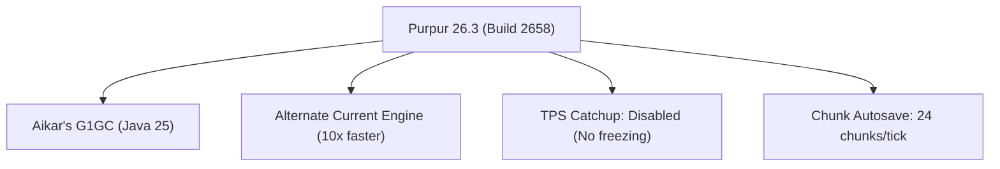

# 📘 เอกสารส่งมอบระบบเซิร์ฟเวอร์ Minecraft Pure Survival
## (Dedicated System Architecture & Handover Blueprint Specification)

> **โครงการ**: Minecraft Pure Survival Server (Vanilla+ & Semi-Community Experience)  
> **เวอร์ชั่นระบบ**: Purpur 26.3 (Build 2658) บน Java 25 LTS  
> **ผู้จัดทำ**: Lead Systems Architect  
> **ทีมงานหลัก**: **คุณมด** (Lead Developer / Base Infrastructure) & **คุณนิว** (Config Specialist / Customization Lead)  
> **วันที่มีผลบังคับใช้**: 16 พฤศจิกายน 2026  
> **Single Source of Truth (SSOT)**: [Google Spreadsheet Data Truth Engine](https://docs.google.com/spreadsheets/d/11hZOHenib5-hMHXeg4HUWR_QvEE462qON4LtOZMkdvY/edit?usp=sharing)

---

## สารบัญ (Table of Contents)
1. [บทสรุปโครงการและวิสัยทัศน์ (Executive Summary)](#1-บทสรุปโครงการและวิสัยทัศน์)
2. [ข้อตกลงการแบ่งงานและส่งมอบ (Team RACI & Handover Boundary)](#2-ข้อตกลงการแบ่งงานและส่งมอบ)
3. [สถาปัตยกรรมเครือข่ายและการอยู่ร่วมกันบนโฮสต์ (Network & Coexistence Shield)](#3-สถาปัตยกรรมเครือข่ายและการอยู่ร่วมกันบนโฮสต์)
4. [โครงสร้างฮาร์ดแวร์และสภาพแวดล้อมระบบ (Hardware & Runtime)](#4-โครงสร้างฮาร์ดแวร์และสภาพแวดล้อมระบบ)
5. [การปรับแต่งประสิทธิภาพระดับ Engine (Purpur & JVM Tuning)](#5-การปรับแต่งประสิทธิภาพระดับ-engine)
6. [สถาปัตยกรรมปลั๊กอิน (Plugin Architecture & Dependencies)](#6-สถาปัตยกรรมปลั๊กอิน)
7. [การวิเคราะห์ระบบเคลมพื้นที่ (Land Protection: GriefPrevention vs Lands)](#7-การวิเคราะห์ระบบเคลมพื้นที่)
8. [ระบบเศรษฐกิจและวงจรการเงิน (Economy & Monetary Flow)](#8-ระบบเศรษฐกิจและวงจรการเงิน)
9. [โครงสร้างยศและสิทธิ์ผู้เล่น (Permission Hierarchy & LuckPerms)](#9-โครงสร้างยศและสิทธิ์ผู้เล่น)
10. [คู่มือการปฏิบัติงานทีละขั้นตอน (Step-by-Step Operations Manual)](#10-คู่มือการปฏิบัติงานทีละขั้นตอน)
11. [ความปลอดภัย การป้องกันการโกง และกู้ภัยฉุกเฉิน (Security & Disaster Recovery)](#11-ความปลอดภัย-การป้องกันการโกง-และกู้ภัยฉุกเฉิน)
12. [แผนงานและเป้าหมายการเปิดตัว (Roadmap & Sprints)](#12-แผนงานและเป้าหมายการเปิดตัว)

---

## 1. บทสรุปโครงการและวิสัยทัศน์
โครงการนี้มีเป้าหมายเพื่อสร้างเซิร์ฟเวอร์ Minecraft เอาชีวิตรอดแท้ (Pure Survival) ที่มีความเสถียรระดับสูงสุด (Rock-solid 20.0 TPS) รองรับผู้เล่นพร้อมกันได้เป็นจำนวนมาก โดยแยกขาดอย่างสิ้นเชิงจากระบบและ dependencies ของ Cobblemon / Pokemon เดิม 

จุดเด่นของระบบ:
- **Zero Cobblemon Content**: ไม่มี Mod โหลดเดอร์ ไม่มี Pokemon entities ที่ผลาญ RAM/CPU
- **Vanilla+ Core**: รักษาเสน่ห์การเอาชีวิตรอดดั้งเดิม แต่เสริมความสะดวกสบายด้วยคำสั่งมาตรฐาน (`/sethome`, `/tpa`, `/spawn`, `/back`)
- **Community Ready**: สถาปัตยกรรมแบบ Modular รองรับระบบกิลด์/แคลน, ตลาดผู้เล่น, เควสต์รายวัน, และแต้มกิจกรรมกิจกรรมในอนาคต

---

## 2. ข้อตกลงการแบ่งงานและส่งมอบ (Team RACI)

เพื่อให้การทำงานระหว่าง **คุณมด** และ **คุณนิว** ลื่นไหล ไม่มีคอขวด และไม่มีการทำงานทับซ้อนกัน จึงกำหนดขอบเขตงานแบบ **"Base $\rightarrow$ Takeover"** ดังนี้:


| หน้าที่ / ขอบเขต | คุณมด (Lead Developer) | คุณนิว (Config & Customization Lead) | จุดส่งมอบ (Handover Gate) |
| :--- | :--- | :--- | :--- |
| **ฐานเซิร์ฟเวอร์ & Engine** | ติดตั้ง Purpur 26.3, Tuning JVM, พอร์ต, สคริปต์รันเซิร์ฟเวอร์ | ตรวจสอบความถูกต้องและทดสอบเชื่อมต่อจริง | รันติด TPS 20.0 นิ่ง |
| **ฐานข้อมูล & สิทธิ์** | เตรียม MySQL Database, ติดตั้ง LuckPerms Jar, เช็ค Connection Pool | เขียนและปรับแต่ง Node สิทธิ์, ยศ, Prefix/Suffix สีภาษาไทย | รัน `/lp editor` ใช้งานได้ |
| **Core Gameplay** | ลง Jar EssentialsX, Spawn, Chat, Protect | แปลข้อความภาษาไทย, ตั้ง Cooldown คำสั่ง, กำหนด Home Limit | ข้อความในเกมอ่านเข้าใจง่าย |
| **ระบบการเงิน (Economy)** | ติดตั้ง Vault, ตรวจสอบ API Hook เข้าฐานข้อมูล | กำหนดเงินเริ่มต้น, ดอกเบี้ย, อัตราภาษีการโอน | ระบบเงินบันทึกข้ามวันไม่หาย |
| **ร้านค้า & ตลาด** | ติดตั้ง EconomyShopGUI / QuickShop, ต่อระบบป้องกันกล่อง | ใส่ราคากลางไอเทมทุกหมวด (พืช, แร่, บล็อก), ป้องกันเงินเฟ้อ | ตารางราคาไม่มีช่องโหว่ปั๊มเงิน |
| **ระบบพื้นที่ (Claim)** | ติดตั้ง Jar เคลม, ตั้งค่าบล็อกป้องกันระเบิด Creeper/TNT | กำหนดบล็อกเคลมเริ่มต้น, อัตราแจกต่อชั่วโมง, ข้อความเตือน | ผู้เล่นทดสอบเคลมบ้านได้สมบูรณ์ |
| **ระบบกิลด์ & เควสต์** | วางโครงสร้างกิลด์ และ Hook ระบบเควสต์เข้ากับสิทธิ์ | เขียนเนื้อหาเควสต์รายวัน, รางวัล, ระบบแต้มกิจกรรม | เควสต์กดรับและเคลียร์ได้จริง |

---

## 3. สถาปัตยกรรมเครือข่ายและการอยู่ร่วมกันบนโฮสต์

เซิร์ฟเวอร์ Survival ทำงานอยู่บนเครื่อง Dedicated Server เดียวกันกับระบบ Cobblemon Network จึงมีมาตรการ **Coexistence Shield** เพื่อป้องกันการชนกันของพอร์ตและหน่วยความจำ:

| Service | พอร์ต (Host Port) | ไดเรกทอรีบนโฮสต์ | สถานะปัจจุบัน | กฎเกณฑ์ความปลอดภัย |
| :--- | :--- | :--- | :--- | :--- |
| **Survival Game** | **`25566` (TCP/UDP)** | `C:\Users\Administrator\Desktop\survival` | **ONLINE (PID 18844)** | พอร์ตเฉพาะของ Survival (ผู้เล่นเข้าตรง) |
| **Survival RCON** | **`25577` (TCP)** | Remote Console | **ONLINE (Password Protected)** | พอร์ตเฉพาะสำหรับ Admin CLI |
| **MySQL (MariaDB)**| `3306` (Localhost) | Windows Service | RUNNING | ให้สร้าง Database แยกชื่อ `survival_*` |
| **Redis Cache** | `6379` (Localhost) | `C:\Users\Administrator\Desktop\Redis...` | RUNNING | พร้อมใช้งานสำหรับ Caching |
| *Velocity Proxy* | `25565` | `Desktop\cbm\proxy` | RUNNING (Cobblemon) | ⛔ **ห้ามแตะต้อง / ห้ามแย่งพอร์ต** |
| *Cobblemon Main* | `32517` / `25575` | `Desktop\cbm\cbm` | RUNNING (Cobblemon) | ⛔ **ห้ามแตะต้อง / ห้ามแย่งพอร์ต** |
| *Lobby Server* | `11782` / `25576` | `Desktop\cbm\lobby` | RUNNING (Cobblemon) | ⛔ **ห้ามแตะต้อง / ห้ามแย่งพอร์ต** |

---

## 4. โครงสร้างฮาร์ดแวร์และสภาพแวดล้อมระบบ
- **โฮสต์**: Dedicated Server `45.154.27.246`
- **CPU**: Intel Core i9-12900K (16 Cores / 24 Threads)
- **RAM ทั้งหมด**: 64 GB (แบ่งให้ Survival Min 8 GB / Max 12 GB)
- **Java Runtime**: Java 25 LTS (`C:\Program Files\Eclipse Adoptium\jdk-25.0.5+8\bin\java.exe`)
- **ระบบป้องกันคอนโซลค้าง (Windows QuickEdit Disabler)**:
  - ฝังโค้ดปลดล็อก QuickEdit ใน `#Start.bat` เพื่อป้องกันเซิร์ฟเวอร์หยุดทำงานเมื่อเผลอคลิกเมาส์บนหน้าต่าง Terminal

---

## 5. การปรับแต่งประสิทธิภาพระดับ Engine (Purpur & JVM Tuning)



1. **JVM Aikar's Flags (Java 25)**:
   - เปิดใช้ `AlwaysPreTouch` เพื่อจองหน่วยความจำไว้ล่วงหน้า ป้องกัน Memory Allocation Lag
   - กำหนดขนาด Heap Region เป็น 8MB และ Reserve Percent 20%
2. **Redstone Engine**:
   - เปิดใช้งาน `ALTERNATE_CURRENT` ใน `paper-world-defaults.yml` ช่วยลด Tick overhead จากวงจรเรดสโตนของผู้เล่นลงกว่า 90%
3. **Tick Drop Protection**:
   - ปิด `tps-catchup: false` เพื่อป้องกันปัญหาเวลากระตุกแล้วเซิร์ฟเวอร์พยายามเร่งความเร็วชดเชยจนค้าง

---

## 6. สถาปัตยกรรมปลั๊กอิน (Plugin Architecture & Dependencies)

```
[Core Infrastructure]
 ├── LuckPerms (v5.4+) ──> ต่อ MySQL (survival_luckperms)
 ├── Vault (v1.7.3+) ────> Core Economy API Bridge
 └── EssentialsX ────────> คำสั่งพื้นฐาน (Spawn, Home, TPA, Warp)

[Gameplay & Security]
 ├── Land Claim ─────────> GriefPrevention หรือ Lands
 ├── World Pre-gen ──────> Chunky (Pre-generate 10,000 blocks)
 └── Security ───────────> GrimAC (Anti-Cheat) + CoreProtect (Rollback)

[Community & Monetization]
 ├── Server Shop ────────> EconomyShopGUI
 ├── Player Market ──────> QuickShop-Hikari
 ├── Clans / Guilds ─────> UltimateClans
 ├── Daily Quests ───────> BeautyQuests
 └── Visual & QoL ───────> TAB + SleepMost
```

---

## 7. การวิเคราะห์ระบบเคลมพื้นที่ (Land Protection)

เนื่องจากข้อ 4 ยังไม่ได้ข้อสรุป จึงทำตารางเปรียบเทียบเพื่อให้คุณมดและคุณนิวพิจารณา:

| ปัจจัยเปรียบเทียบ | GriefPrevention (ทางเลือก A) | Lands (ทางเลือก B) |
| :--- | :--- | :--- |
| **แนวคิดหลัก** | พลั่วทองคลาสสิก ลากเส้นทแยงมุมเคลม | ระบบจัดการที่ดินแบบ Modern (โฉนด/ประเทศ/เมือง) |
| **ความง่ายสำหรับผู้เล่น** | ง่ายมาก ผู้เล่นคุ้นเคยเกือบทุกคน | มี GUI สวยงาม แต่ผู้เล่นใหม่อาจต้องศึกษาเล็กน้อย |
| **ฟีเจอร์ขั้นสูง** | พื้นฐาน (แชร์สิทธิ์, ป้องกันการขโมยของ) | มีระบบเก็บภาษีที่ดิน, การเช่าพื้นที่, เลเวลเมือง |
| **ภาระคอนฟิก (นิว)** | ต่ำ (แก้ 1-2 ไฟล์เสร็จ) | ปานกลาง-สูง (ปรับแต่ง GUI, ภาษี, ธงสิทธิ์) |
| **ข้อเสนอแนะ** | **เหมาะมากช่วงเปิดแรกๆ** เพื่อความเสถียร | **เหมาะสำหรับต่อยอดเป็นระบบกิลด์/ประเทศ** |

---

## 8. ระบบเศรษฐกิจและวงจรการเงิน (Economy & Monetary Flow)

เพื่อป้องกันปัญหาเงินเฟ้อ (Hyperinflation) ที่พบบ่อยในเซิร์ฟเวอร์ Survival ได้วางกลไก **Money Sink & Source Balance** ไว้ดังนี้:

```
[Money Sources (เงินเข้ากระเป๋าผู้เล่น)]
  ├── ขายผลผลิตเกษตร/แร่ ให้ Server Shop (ราคากลางจำกัดโควต้า)
  ├── ค่าตอบแทนจากการทำงาน (Jobs)
  └── ของรางวัลจากเควสต์รายวัน (Daily Quests)

[Money Sinks (เงินออกจากระบบเซิร์ฟเวอร์)]
  ├── ภาษีการซื้อขายในตลาดผู้เล่น (Market Tax 3% - 5%)
  ├── ค่าธรรมเนียมการตั้งร้านค้า / ค่าเช่าที่ดิน
  ├── การซื้อไอเทมพิเศษที่คราฟต์ไม่ได้ (Name Tag, Saddle, Bell)
  └── ค่าธรรมเนียมการอัปเกรดกิลด์และคลังรวม
```

---

## 9. โครงสร้างยศและสิทธิ์ผู้เล่น (Permission Hierarchy)

การจัดลำดับชั้นสิทธิ์ใน LuckPerms แบ่งเป็น 7 ระดับ โดยสืบทอดสิทธิ์ (Inheritance) จากล่างขึ้นบน:

```
[Admin] (มด & นิว - สิทธิ์เต็ม '*')
   ▲
[Moderator] (ตรวจจับการโกง, Ban, Rollback)
   ▲
[Helper] (ช่วยตอบคำถาม, Mute, Kick)
   ▲
[MVP] (10 Homes, 5,000 Claim Blocks, บินในเขตเคลมได้)
   ▲
[VIP] (5 Homes, 2,500 Claim Blocks, โต๊ะคราฟต์พกพา)
   ▲
[Member] (3 Homes, 1,000 Claim Blocks, /sethome, /tpa)
   ▲
[Default] (ผู้มาเยือน - ห้ามเคลมจนกว่าจะผ่านเควสต์สอนเล่น)
```

---

## 10. คู่มือการปฏิบัติงานทีละขั้นตอน (Step-by-Step Operations Manual)

### ก. การลงปลั๊กอินใหม่ (สำหรับคุณมด)
1. นำไฟล์ `.jar` วางไว้ในเครื่อง หรือโฟลเดอร์ `staging/` ในโปรเจกต์
2. รันคำสั่งผ่านสคริปต์เพื่อส่งขึ้นเซิร์ฟเวอร์:
   ```cmd
   .\deploy.bat path\to\PluginName.jar
   ```
   *(ไฟล์จะถูกอัปโหลดเข้าสู่ `update_staging\` บนเซิร์ฟเวอร์โดยอัตโนมัติ)*
3. รันคำสั่งรีสตาร์ทเซิร์ฟเวอร์แบบนุ่มนวลผ่าน RCON:
   ```cmd
   .\rcon.bat restart
   ```

### ข. การปรับแต่งคอนฟิก (สำหรับคุณนิว)
1. ดึงไฟล์คอนฟิกจากเซิร์ฟเวอร์ลงมาดูในเครื่อง:
   ```cmd
   python scripts/remote_ops.py download "C:\Users\Administrator\Desktop\survival\plugins\Essentials\config.yml" ./config.yml
   ```
2. แก้ไขไฟล์คอนฟิกในโปรแกรมตามต้องการ (ภาษาไทย, Cooldown, ค่าเงิน)
3. อัปโหลดไฟล์ที่แก้เสร็จแล้วกลับขึ้นเซิร์ฟเวอร์:
   ```cmd
   python scripts/remote_ops.py upload ./config.yml "C:\Users\Administrator\Desktop\survival\plugins\Essentials\config.yml"
   ```
4. สั่ง Reload ปลั๊กอินผ่าน RCON โดยไม่ต้องปิดเซิร์ฟเวอร์:
   ```cmd
   .\rcon.bat "ess reload"
   ```

### ค. การตรวจสอบสถานะเซิร์ฟเวอร์
```cmd
:: เช็ค Ping, ผู้เล่นออนไลน์ และความหน่วง
.\status.bat

:: เช็ค TPS และสุขภาพ Engine
.\rcon.bat tps
```

---

## 11. ความปลอดภัย การป้องกันการโกง และกู้ภัยฉุกเฉิน

1. **Anti-Dupe & Inventory Safety**:
   - ปิดกลไกการชนกันของเอนทิตีที่อาจทำให้เกิด Glitch การโคลนไอเทม
   - บังคับบันทึกข้อมูลผู้เล่นทันทีเมื่อเกิดเหตุการณ์ตัดการเชื่อมต่อ
2. **CoreProtect Rollback SOP**:
   - หากมีเหตุการณ์เกรียนบ้านหรือทำลายพื้นที่ ให้พิมพ์คำสั่งในเกมหรือผ่าน RCON:
     ```
     /co rollback t:24h r:50 u:GrieferName
     ```
3. **Automated Backup Strategy**:
   - โฟลเดอร์ `world`, `world_nether`, `world_the_end` ควรทำ Shadow Copy หรือ Zip สำรองทุกตี 4 ของวัน

---

## 12. แผนงานและเป้าหมายการเปิดตัว (Roadmap & Sprints)

```
[Phase 1: Foundation (Day 1 - 4)] 
  ✅ Purpur 26.3 Setup & Ports 25566/25577
  ⏳ LuckPerms MySQL Database & Groups
  ⏳ World Border 10kx10k & Chunky Pre-generation

[Phase 2: Economy & Claims (Day 5 - 9)]
  ⏳ EssentialsX Vanilla+ Core Configuration
  ⏳ Vault Economy & Server Admin Shop Pricing
  ⏳ Land Protection Setup (GriefPrevention / Lands)

[Phase 3: Community & RPG (Day 10 - 15)]
  ⏳ QuickShop Player Market & Trading
  ⏳ Clans / Guilds System Setup
  ⏳ Daily Quests & Activity Points System

[Phase 4: Launch Readiness (Day 16 - 22+)]
  ⏳ Anti-Cheat & Exploit Defense Testing
  ⏳ Internal Stress Test (นิว & มด)
  ⏳ Closed Beta Test (30-50 Players)
  ⏳ Official Launch (OBT)
```

---

> ข้อมูลตารางตัวเลขทั้งหมดถูกผูกไว้ที่ [Google Sheets Data Truth Engine](https://docs.google.com/spreadsheets/d/11hZOHenib5-hMHXeg4HUWR_QvEE462qON4LtOZMkdvY/edit?usp=sharing) สามารถอัปเดตและติดตามความคืบหน้าร่วมกันได้ตลอด 24 ชั่วโมง
